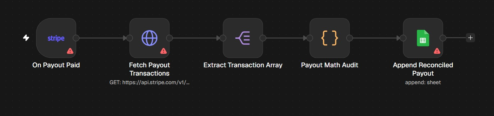
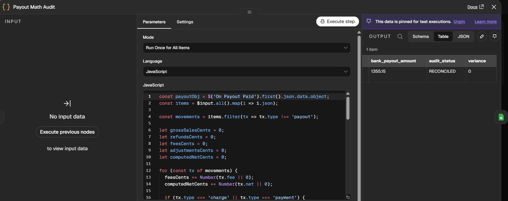

# n8n Stripe Payout & Fee Reconciliation Workflow (Google Sheets)

Deterministic 5-node **n8n** workflow that listens to Stripe `payout.paid` events, retrieves all underlying balance transactions, separates gross sales from refunds and processing fees, and verifies exact mathematical reconciliation before logging entries into **Google Sheets**.



> **Turnkey Deployment Kit:** Download the ready-to-import `.json` workflow, 13-column `.csv` ledger template, and setup manual on [Payhip](https://payhip.com/Kronix700).

## Pipeline Architecture

1. **Stripe Trigger (`On Payout Paid`):** Listens for real-time `payout.paid` webhooks and captures the payout ID (`{{ $json.data.object.id }}`), net bank transfer amount in cents, currency, and arrival date.
2. **HTTP Request (`Fetch Payout Transactions`):** Queries `GET https://api.stripe.com/v1/balance_transactions` filtered by `payout={{ $json.data.object.id }}` using a restricted read-only Stripe API key.
3. **Split Out (`Extract Transaction Array`):** Expands the `data` array into individual balance movement items (`charge`, `refund`, `adjustment`).
4. **Code Node (`Payout Math Audit`):** Excludes the outbound `payout` transfer entry to prevent double-counting, converts cents to decimal units, aggregates totals, and validates $\text{Gross Sales} - \text{Refunds} - \text{Stripe Fees} + \text{Adjustments} = \text{Bank Payout Amount}$ within a `$0.01` tolerance.
5. **Google Sheets (`Append Reconciled Payout`):** Appends the audited payout summary row to the `Payout_Ledger` tab.

## Deterministic Reconciliation Logic

```javascript
const payoutObj = $('On Payout Paid').first().json.data.object;
const items = $input.all().map(i => i.json);

const movements = items.filter(tx => tx.type !== 'payout');

let grossSalesCents = 0;
let refundsCents = 0;
let feesCents = 0;
let adjustmentsCents = 0;
let computedNetCents = 0;

for (const tx of movements) {
  feesCents += Number(tx.fee || 0);
  computedNetCents += Number(tx.net || 0);

  if (tx.type === 'charge' || tx.type === 'payment') {
    grossSalesCents += Number(tx.amount || 0);
  } else if (tx.type === 'refund' || tx.type === 'payment_refund') {
    refundsCents += Math.abs(Number(tx.amount || 0));
  } else {
    adjustmentsCents += Number(tx.amount || 0);
  }
}

const expectedPayout = Number(payoutObj.amount || 0) / 100;
const computedNet = computedNetCents / 100;
const variance = Math.abs(computedNet - expectedPayout);

return [{
  json: {
    reconciled_at: new Date().toISOString(),
    payout_id: payoutObj.id,
    arrival_date: new Date(payoutObj.arrival_date * 1000).toISOString().split('T')[0],
    currency: (payoutObj.currency || 'usd').toUpperCase(),
    transaction_count: movements.length,
    gross_sales: Number((grossSalesCents / 100).toFixed(2)),
    refunds: Number((refundsCents / 100).toFixed(2)),
    stripe_fees: Number((feesCents / 100).toFixed(2)),
    adjustments: Number((adjustmentsCents / 100).toFixed(2)),
    net_computed: Number(computedNet.toFixed(2)),
    bank_payout_amount: Number(expectedPayout.toFixed(2)),
    audit_status: variance <= 0.01 ? 'RECONCILED' : 'PAYOUT_VARIANCE',
    variance: Number(variance.toFixed(2))
  }
}];
```



## Google Sheets Schema (`Payout_Ledger`)

```csv
reconciled_at,payout_id,arrival_date,currency,transaction_count,gross_sales,refunds,stripe_fees,adjustments,net_computed,bank_payout_amount,audit_status,variance
```

## Download Package

* **[Get the n8n Stripe Payout Reconciliation Kit on Payhip](https://payhip.com/Kronix700)** — Includes `stripe-payout-reconciliation-n8n.json`, `Stripe_Payout_Ledger_Template.csv`, and `Stripe_Setup_Guide.pdf`.
